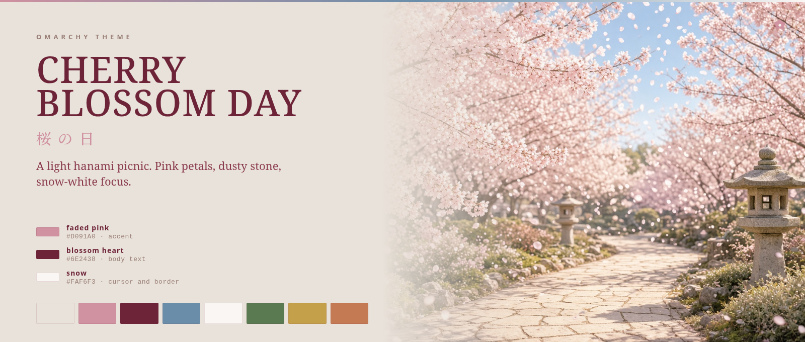
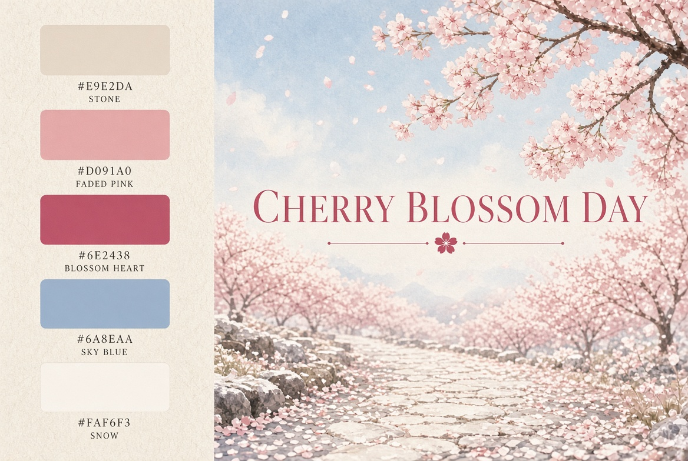
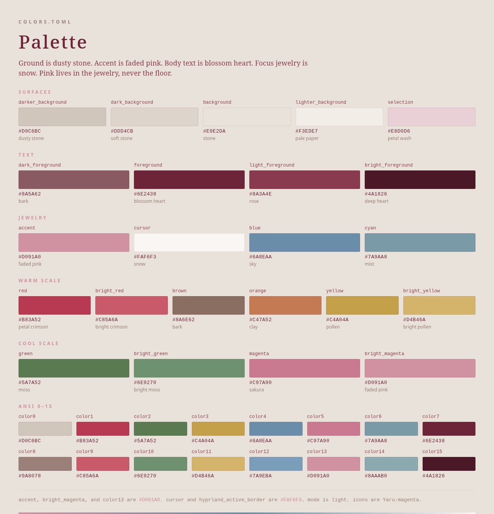
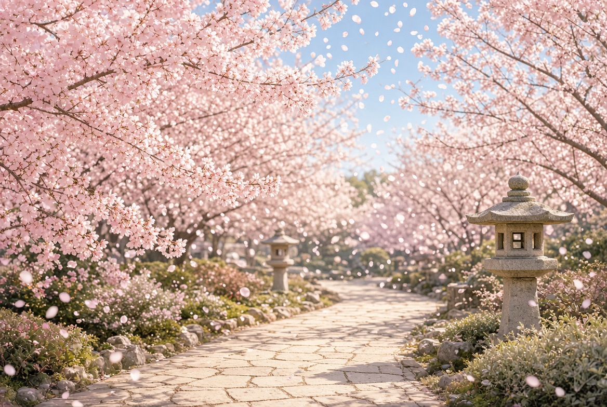
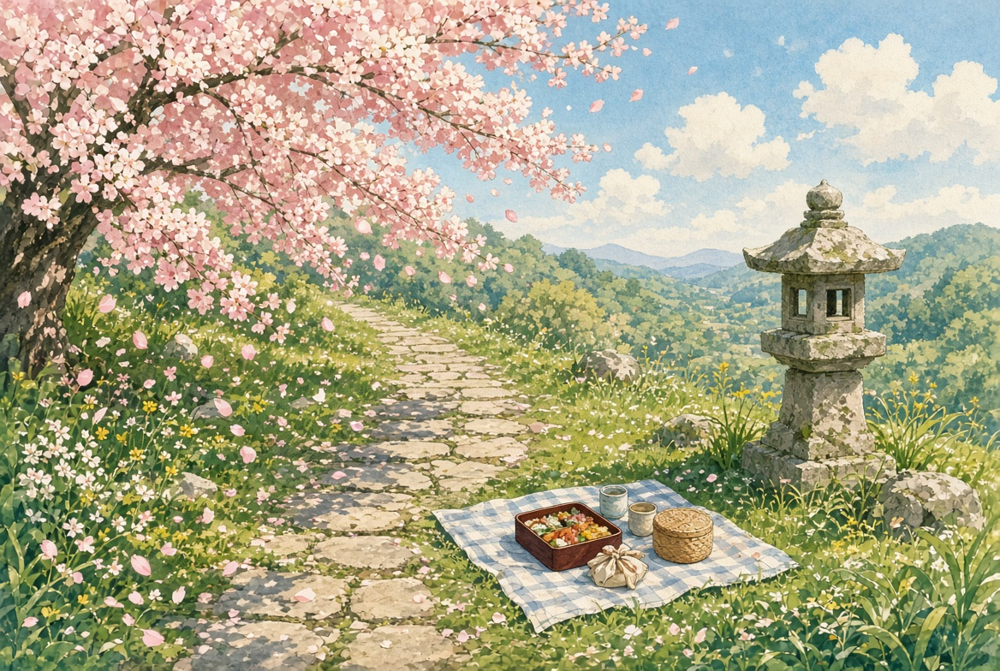
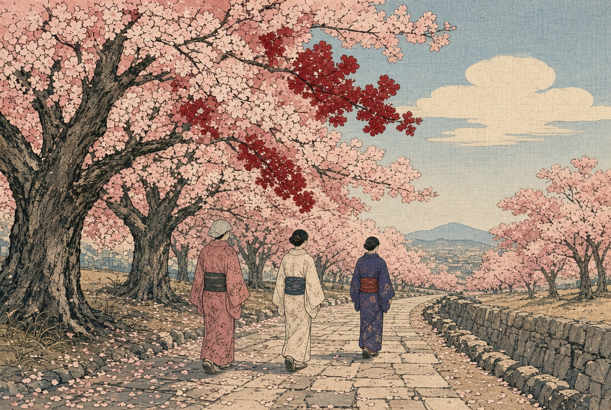
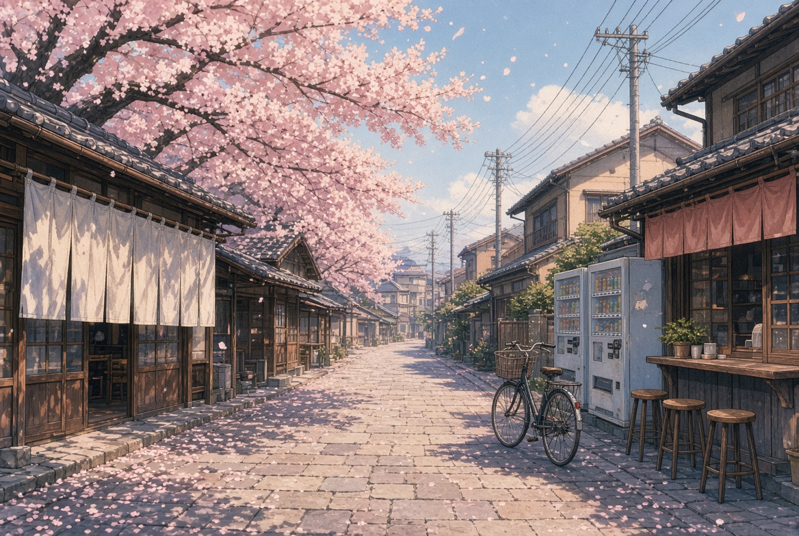
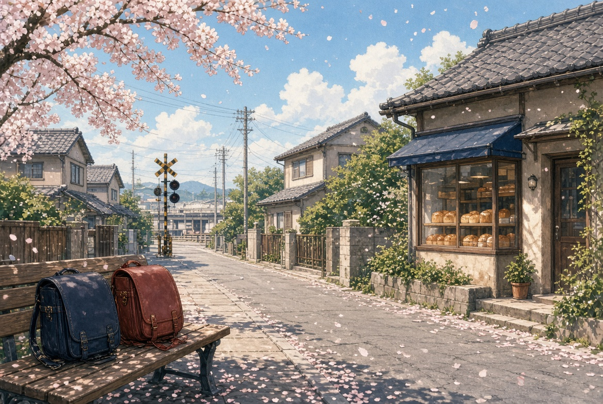
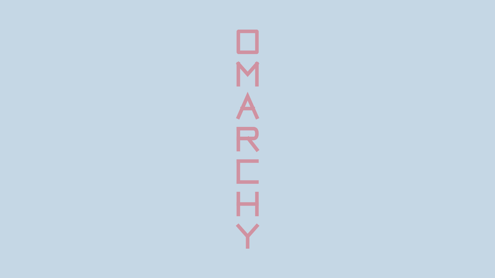

<p align="center">
  
</p>

<h1 align="center">桜の日 · Cherry Blossom Day</h1>

<p align="center">
  A light Omarchy theme cut from a hanami picnic.<br>
  Dusty stone, faded pink, blossom-heart ink, snow-white focus.
</p>

Cherry Blossom Day is morning under the trees. This repo is that palette for [Omarchy](https://omarchy.org): `colors.toml`, ten wallpapers, the theme mark, and a light-mode flag so the whole desktop stays on paper instead of charcoal.

## Install

The repository name is part of the install. Omarchy strips a leading `omarchy-` and a trailing `-theme`, so this repo lands on disk as `cherry-blossom-day`.

```bash
omarchy theme install https://github.com/toddvasquez/omarchy-cherry-blossom-day-theme.git
```

That clones into `~/.config/omarchy/themes/cherry-blossom-day` and applies the theme. If that directory already exists, the installer replaces it.

```bash
omarchy theme current
omarchy theme bg next
```

`omarchy theme bg next` walks the wallpapers in filename order, `1` through `10`.

Omarchy rebuilds terminal, bar, lock, and editor colors from `colors.toml`. A theme installed from git does not get to run its own Lua.

<p align="center">
  
</p>

## Palette

Ground is `#E9E2DA`. The accent, bright magenta, and ANSI 13 are the same faded pink, `#D091A0`. Body text is blossom heart, `#6E2438`. The cursor and the Hyprland focus border are snow, `#FAF6F3`. Pink lives in the jewelry. The floor stays dusty.

<p align="center">
  
</p>

| | Hex | Where it sits |
| --- | --- | --- |
| Stone | `#E9E2DA` | `background` |
| Dusty stone | `#D0C6BC` | `darker_background` |
| Pale paper | `#F3EDE7` | `lighter_background` |
| Blossom heart | `#6E2438` | `foreground` |
| Deep heart | `#4A1826` | `bright_foreground` |
| Dusty bark | `#9A8078` | `muted` |
| Faded pink | `#D091A0` | `accent` |
| Snow | `#FAF6F3` | `cursor`, `hyprland_active_border` |
| Sky | `#6A8EAA` | `blue` |
| Moss | `#5A7A52` | `green` |
| Petal crimson | `#B83A52` | `red` |
| Pollen | `#C4A04A` | `yellow` |

`icons.theme` names `Yaru-magenta`. `mode` is `light`, and `light.mode` is kept for older Omarchy.

## Wallpapers

<p align="center">
  
  
  
</p>

<p align="center">
  
  
  
</p>

<p align="center">
  
  
  
  
</p>

| File | Plate |
| --- | --- |
| `backgrounds/1-hanami-path.jpg` | Stone path, lanterns, full bloom |
| `backgrounds/2-hillside-picnic.jpg` | Bento on the hill |
| `backgrounds/3-ukiyoe-avenue.jpg` | Three walkers, woodblock sky |
| `backgrounds/4-swirl-buck-sakura.jpg` | Buck, petals, sky swirl |
| `backgrounds/5-shotengai-90s.jpg` | Shopping street at noon |
| `backgrounds/6-station-street-90s.jpg` | Randoseru by the bakery |
| `backgrounds/7-wordmark.jpg` | The word, thin and pink |
| `backgrounds/8-omarchy-emblem.jpg` | The mark |
| `backgrounds/9-omarchy-pixel.jpg` | The word, pixel |
| `backgrounds/10-omarchy-tategaki.jpg` | The word, tategaki |

## Build

`colors.toml` is the source. The graphics target redraws the palette plate from it and checks the theme and the images.

```bash
bash scripts/render_graphics.sh
bash scripts/check.sh
```

`make` runs those two targets when Make is installed. Rendering needs Chromium and ImageMagick.

## Layout

```text
colors.toml          palette Omarchy generates from
icons.theme          Yaru-magenta
light.mode           light-mode flag for older Omarchy
preview.png          theme-switcher mark
backgrounds/         ten wallpapers
docs/                README plates
```

## License

[MIT](LICENSE). The palette, the wallpapers, and the mark ship together so the theme can be installed as a whole.
